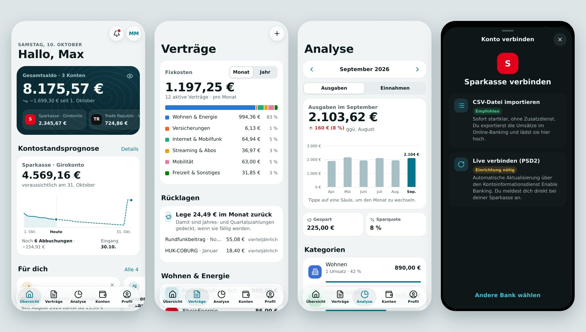
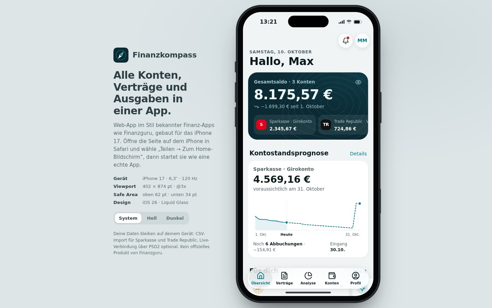

# Finanzkompass – Finanz-App im Stil von Finanzguru für das iPhone 17

Eine Web-App mit den wichtigsten Funktionen von Multibanking-Apps wie Finanzguru: Konten, erkannte Verträge, Kontostandsprognose, Ausgabenanalyse und Budgets – auf Basis deiner **echten Umsätze von Sparkasse und Trade Republic**. Sie ist für das **iPhone 17** gebaut (402 × 874 pt, Safe Areas oben 62 pt und unten 34 pt) und nutzt das Liquid-Glass-Design von iOS 26. Auf großen Bildschirmen erscheint die App in einem iPhone-17-Rahmen.



> **Deine Daten bleiben bei dir.** Umsätze werden nur im Browser deines Geräts gespeichert. Für den CSV-Import gibt es keinen Server, die optionale Live-Verbindung läuft über deinen eigenen Proxy. Name und Logo sind bewusst eigenständig, weil „Finanzguru“ eine geschützte Marke ist – kein offizielles Produkt von Finanzguru.

## Schnellstart mit Docker (Windows)

Voraussetzung: [Docker Desktop](https://www.docker.com/products/docker-desktop/) ist installiert und gestartet.

```powershell
git clone -b claude/finanzguru-app-website-7tw1sf https://github.com/waltersen01/calculator.git D:\Finanzguru_clone
cd D:\Finanzguru_clone
docker compose up -d --build
```

Danach `http://localhost:8080` öffnen. Ohne Git: das Projekt als ZIP herunterladen, nach `D:\Finanzguru_clone` entpacken und dort `start-windows.cmd` doppelklicken – das Skript baut den Container, startet ihn und öffnet den Browser.

| Aufgabe | Befehl (im Ordner `D:\Finanzguru_clone`) |
| --- | --- |
| Starten | `docker compose up -d --build` oder `start-windows.cmd` |
| Beenden | `docker compose down` oder `stop-windows.cmd` |
| Aktualisieren | `git pull`, danach `docker compose up -d --build` |
| Anderer Port | in `.env` (Vorlage `.env.example`) `APP_PORT=9000` setzen |

Der Container enthält nur die App und einen nginx-Webserver ohne Root-Rechte. Deine Umsätze speichert der Browser, nicht der Container: Ein Update oder Neustart des Containers löscht nichts. Wenn du die Browserdaten löschst, sind sie aber weg – exportiere deshalb unter **Profil → Backup exportieren** regelmäßig eine Sicherung.

**Auf dem iPhone im WLAN:** Öffne `http://<IP-deines-PCs>:8080` in Safari (die IP zeigt `ipconfig` in PowerShell; die Windows-Firewall fragt beim ersten Mal nach). Mit **Teilen → Zum Home-Bildschirm** startet die App wie eine native App. Jedes Gerät hat seinen eigenen Datenbestand.

## Konten verbinden

Beim ersten Start führt dich die App durch die Verbindung. Doppelte Umsätze werden bei jedem weiteren Import erkannt und übersprungen.

### Sparkasse (CSV)

1. Im Browser im Online-Banking deiner Sparkasse anmelden.
2. Umsätze des Girokontos öffnen und einen Zeitraum wählen, am besten die letzten 12 Monate.
3. **Exportieren** → Format **Excel (CSV-CAMT V2)** wählen (CSV-MT940 funktioniert auch).
4. In der App **Sparkasse verbinden → CSV-Datei importieren** und die Datei auswählen.
5. Den aktuellen Kontostand eintragen – daraus berechnet die App den Verlauf.

### Trade Republic (CSV)

1. In der App oder unter app.traderepublic.com **Profil → Kontoauszüge → Transaktionsexport** öffnen.
2. Zeitraum „seit Kontoeröffnung“ wählen und die CSV-Datei erstellen.
3. In Finanzkompass **Trade Republic verbinden → CSV-Datei importieren** wählen.

Die App legt das Verrechnungskonto mit Kartenzahlungen, Zinsen, Ein- und Auszahlungen an und auf Wunsch ein Depot. Den Depotwert schätzt sie mit dem letzten Ausführungskurs deiner Käufe und Verkäufe – aktuelle Börsenkurse ruft sie nicht ab. Sparraten vom Girokonto an Trade Republic zählen nicht als Ausgabe, sondern als Sparen bzw. Umbuchung zwischen deinen Konten.

### Andere Banken

Jede Bank, die Umsätze als CSV exportiert, funktioniert über **Andere Bank per CSV-Datei**. Bekannte Spaltennamen (z. B. von DKB oder ING) erkennt die App selbst, sonst ordnest du Datum, Betrag, Empfänger und Verwendungszweck einmal zu.

### Live-Verbindung (PSD2, optional)

Statt CSV-Dateien kannst du Konten automatisch über den regulierten Kontoinformationsdienst [Enable Banking](https://enablebanking.com) abrufen. Du meldest dich dabei direkt bei deiner Bank an (z. B. mit S-pushTAN); die App sieht keine Zugangsdaten und hat nur Lesezugriff. Den API-Schlüssel verwahrt ein kleiner Proxy, den du selbst betreibst – im Docker-Setup als zweiter Container:

```powershell
copy .env.example .env      # EB_APP_ID und ACCESS_TOKEN eintragen
# privaten Schlüssel aus dem Enable Banking Control Panel als secrets\enablebanking.pem speichern
docker compose --profile live up -d --build
```

In der App unter **Profil → Live-Verbindung** wird der Proxy automatisch erkannt (`/api`); du trägst nur noch das Zugriffstoken ein. Die vollständige Anleitung, auch für einen Cloudflare Worker statt Docker, steht in [`server/README.md`](server/README.md).

## Funktionen

**Übersicht**
- Gesamtsaldo über alle Konten mit Veränderung seit Monatsbeginn, Beträge per Auge-Symbol ausblendbar
- Kontostandsprognose bis Monatsende aus erkannten Verträgen, Gehaltseingang, Daueraufträgen und deinen durchschnittlichen Alltagsausgaben
- Hinweise wie Preiserhöhungen, neu erkannte Verträge, drohendes Minus, Abo-Check, Rücklagen, Budget-Warnungen und veraltete Importe
- Monatsbilanz (Einnahmen, Ausgaben, Gespart), anstehende Abbuchungen, letzte Umsätze

**Verträge**
- Automatisch erkannt aus wiederkehrenden Abbuchungen: gleicher Empfänger, ähnlicher Betrag, monatlicher bis jährlicher Rhythmus – auch über PayPal
- Mehrere Verträge beim selben Anbieter werden über die Mandatsreferenz getrennt
- Fixkosten pro Monat oder Jahr nach Bereichen, Rücklagen für Quartals- und Jahreszahlungen
- Preisentwicklung, Zahlungshistorie, Gläubiger-ID und Mandatsreferenz
- **Kündigungsschreiben** in drei Schritten zum Kopieren oder als E-Mail; das Vertragsende vermerkst du selbst
- Vergleichsportale, eigene Verträge anlegen, Fehlerkennungen ausblenden

**Analyse**
- Ausgaben und Einnahmen pro Monat mit Vormonatsvergleich (im laufenden Monat fair bis zum gleichen Tag)
- Säulendiagramm der letzten 6 Monate, Kategorien mit Anteilen, Sparquote
- Budgets mit Fortschrittsbalken, Tagesbudget und Warnstufen
- Automatische Kategorien über rund 130 bekannte Händler, Kartenbranchen-Codes (MCC) und Schlüsselwörter

**Konten & Umsätze**
- Girokonten, Verrechnungskonto und Depot mit Saldoverlauf (30 Tage, 90 Tage, 1 Jahr)
- Volltextsuche und Filter über alle Umsätze, Umsatzdetails mit Verwendungszweck und Notizen
- Kategorie ändern, auf Wunsch für alle Umsätze desselben Händlers
- Kontostand korrigieren, Konto umbenennen oder entfernen

**Profil**
- Hell, Dunkel oder System, Beträge ausblenden, Sperrbildschirm als Sichtschutz
- Backup exportieren und wiederherstellen, alle Daten löschen

## Ohne Docker starten

Die App braucht keinen Build-Schritt und keine Abhängigkeiten:

```bash
python3 -m http.server 8000   # oder: npx serve .
```

Dann `http://localhost:8000` öffnen. Zum Hosten eignet sich jeder statische Webspace, zum Beispiel GitHub Pages (**Settings → Pages**, Branch und Ordner `/ (root)` wählen).



## Projektstruktur

```
index.html              Einstieg, PWA-Metadaten
manifest.webmanifest    Web-App-Manifest
css/app.css             Design-Tokens (Hell/Dunkel), iPhone-Rahmen, Komponenten
js/core.js              HTML-Templates mit Escaping, Formatierung (de-DE), Datum, Feiertage
js/config.js            App-Name und Version
js/catalog.js           Kategorien, Banken, bekannte Händler und Regeln (keine Umsätze)
js/importers.js         CSV-Import: Sparkasse, Trade Republic, andere Banken
js/categorize.js        Kategorien und Anzeigenamen für importierte Umsätze
js/recurring.js         Erkennung von Verträgen, Gehalt und Daueraufträgen
js/store.js             Zustand und Auswertungen: Salden, Prognose, Analyse, Verträge, Hinweise
js/live.js              Live-Verbindung über Enable Banking (PSD2)
js/ui.js, charts.js     Bausteine, Sheets, Toasts, SVG-Diagramme
js/router.js            Tabs mit eigenem Navigationsstapel, Hash-URLs, Übergänge
js/screens/*.js         Übersicht, Verträge, Analyse, Konten, Profil, Konto verbinden
js/app.js               Start, Theme, Gerätrahmen, Sperrbildschirm
server/                 Proxy für die Live-Verbindung (Docker oder Cloudflare Worker)
Dockerfile, nginx/      App-Container (nginx ohne Root-Rechte, Sicherheits-Header)
docker-compose.yml      App und optionaler Proxy (Profil „live“)
start-windows.cmd       Starten unter Windows per Doppelklick
```

## Anpassen

- **App-Name:** `js/config.js`
- **Farben:** Tokens am Anfang von `css/app.css`, jeweils für Hell und Dunkel
- **Händler und Kategorien:** `js/catalog.js` – eine Zeile pro Marke mit Name, Farbe, Kategorie und Suchmuster
